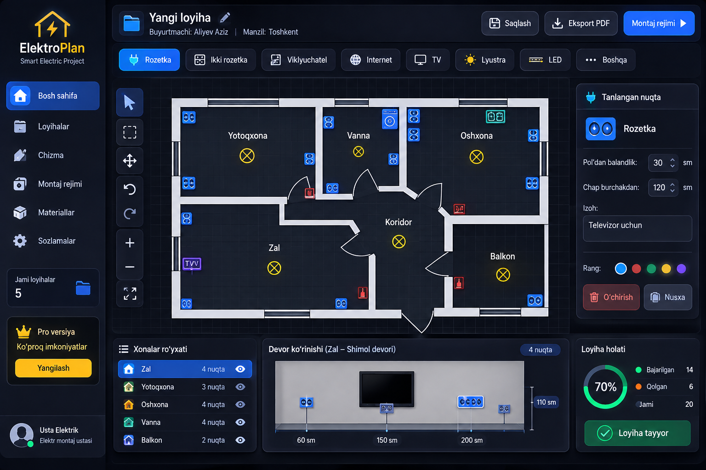

# ⚡ ElektroPlan — Smart Electric Project

Elektr montaj ustalari uchun professional 2D elektr loyihalash va montaj ilovasi.
**iPad uchun birinchi navbatda**, shuningdek iPhone, Android va Windows’da ishlaydi (PWA). **Internetsiz ham** saqlangan loyihalarni ochib ko‘rish va tahrirlash mumkin.



## Usta nima qila oladi

1. Yangi loyiha yaratadi (buyurtmachi, manzil).
2. Xonalarni vizual chizadi va nomlaydi (o‘lcham majburiy emas — bu CAD emas).
3. Devorlarga elektr belgilarini qo‘yadi (rozetka, viklyuchatel, internet, TV, lyustra, LED, konditsioner…).
4. Har bir nuqtani sozlaydi: poldan balandlik, chap burchakdan masofa, izoh, rang.
5. Devor ko‘rinishida nuqtalarni ko‘radi va tahrirlaydi.
6. Montaj rejimida nuqtalarni “Kutilmoqda → Jarayonda → Bajarildi” deb belgilaydi.
7. Loyihani PDF qilib eksport qiladi.
8. Internet yo‘q joyda barcha saqlangan loyihalarni ochadi va ishlaydi; internet qaytganda serverga avtomatik sinxronlanadi.

## Texnologiyalar

**Frontend:** Next.js (static export) · React · TypeScript strict · Tailwind CSS · shadcn/ui · Konva.js · Zustand · Zod · IndexedDB · PWA (Serwist) · pdf-lib
**Backend:** PHP 8 + MySQL (hostmaster.uz cPanel)
**Test:** Vitest · Playwright (iPad, iPhone, Android, Windows profillari)
**Deploy:** GitHub Actions → FTP → cPanel

## Hujjatlar

| Fayl | Mazmuni |
|---|---|
| [`CLAUDE.md`](CLAUDE.md) | Claude Code uchun qat’iy ish qoidalari |
| [`docs/SPEC.md`](docs/SPEC.md) | To‘liq texnik topshiriq (asl matn) |
| [`docs/ARCHITECTURE.md`](docs/ARCHITECTURE.md) | Arxitektura, hosting qarori, papkalar, offline va sinxron |
| [`docs/DEVICES.md`](docs/DEVICES.md) | iPad / iPhone / Android / Windows moslashuvi |
| [`docs/DATA_MODEL.md`](docs/DATA_MODEL.md) | Domen modeli, geometriya, IndexedDB, MySQL |
| [`server/migrations/`](server/migrations/) | MySQL sxemasi (001, 002) |
| [`docs/DESIGN_SYSTEM.md`](docs/DESIGN_SYSTEM.md) | Ranglar, shriftlar, panellar, UI matnlari |
| [`docs/PHASES.md`](docs/PHASES.md) | 13 bosqich: vazifalar, qabul mezonlari, tayyor promptlar |
| [`docs/DEPLOY.md`](docs/DEPLOY.md) | hostmaster.uz cPanel’ga joylashtirish |
| [`docs/PROGRESS.md`](docs/PROGRESS.md) | Bosqichlar holati |
| [`docs/MANUAL_TEST.md`](docs/MANUAL_TEST.md) | Haqiqiy qurilmalarda qo‘lda tekshiruv ro‘yxati |

## Qanday boshlash

Claude Code’da shu repo’ni oching va yozing:

```
CLAUDE.md va docs/ papkasini to‘liq o‘qi. docs/PHASES.md dagi PHASE 1 ni bajar.
Tugagach test qil, docs/PROGRESS.md ni yangila, hisobot ber va tasdiqimni kut.
```

---
© ITcoDe.Uz

## Ishga tushirish (Phase 1+)

```
pnpm install
pnpm dev            # http://localhost:3000  (demo reja: /?demo=1)
pnpm typecheck && pnpm lint && pnpm test
pnpm build          # statik out/
pnpm test:coverage  # domain/ coverage (chegara: 90 %)
pnpm test:e2e       # 6 qurilma profili (out/ dan + PHP API)
```

Server (PHP + MariaDB) lokal:

```
scripts/test-db.sh start                       # MariaDB 127.0.0.1:3307
EP_DB_HOST=127.0.0.1 EP_DB_PORT=3307 EP_DB_USER=root EP_DB_NAME=ep_dev php server/migrate.php
EP_DB_HOST=127.0.0.1 EP_DB_PORT=3307 EP_DB_USER=root EP_DB_NAME=ep_dev php -S 127.0.0.1:4175 server/index.php
```

Integratsiya va e2e testlari bazani o‘zi yaratadi (`EP_DB_*`); baza bo‘lmasa server testlari o‘tkazib yuboriladi.
